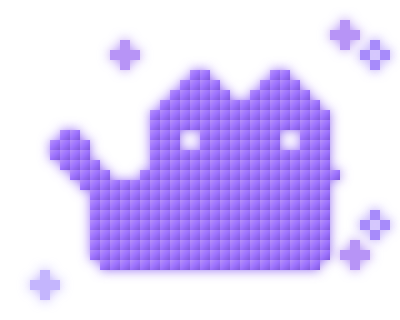
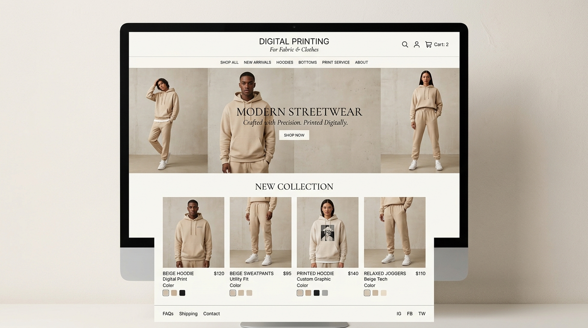

# Antigravity_Portfolio

A static portfolio website for Shojib, presenting work, experience, and contact information through a polished single-page design and scroll-driven visual storytelling.

## Overview

Antigravity_Portfolio is a front-end portfolio website built with plain HTML, CSS, and JavaScript. The project combines a glassmorphic interface with a fixed full-screen canvas that updates as the user scrolls, creating a cinematic motion-driven presentation for portfolio content.

The site is structured as a multi-page portfolio experience with separate landing, about, projects, and contact pages, while sharing a common design system and JavaScript behavior. It is designed to run as a static site with no build step or dependency installation.

## Features

- Multi-page portfolio structure: Home, About, Projects, and Contact
- Full-viewport canvas animation driven by scroll position and a preloaded JPG frame sequence
- Minimal loading overlay with progress feedback while frames load
- Responsive navigation with desktop links and mobile drawer menu
- Active section highlighting based on the current page
- Project filtering and modal detail view on the projects page
- Contact form interaction and email-copy functionality
- Static local preview server using Node.js core modules
- GitHub Pages-ready deployment for a static portfolio site

## Technology Stack

| Technology | Purpose |
|---|---|
| HTML | Page structure across `index.html`, `about.html`, `projects.html`, and `contact.html` |
| CSS | Visual design system, responsive layout, glass effects, typography, animations, and page styling |
| JavaScript | Scroll-driven animation, canvas rendering, navigation behavior, project filtering, modal logic, and contact interactions |
| Node.js | Local development server in `server.js` |
| JPG / SVG assets | Portfolio imagery, frame sequence, and brand illustrations |

## Project Structure

```text
Antigravity_Portfolio/
├── about.html
├── assets/
│   ├── me.png
│   ├── pixel-cat.svg
│   ├── project-chrome.jpg
│   ├── project-fabric.jpg
│   ├── project-headphones.jpg
│   ├── project-jacket.jpg
│   ├── project-player.jpg
│   └── project-saas.jpg
├── contact.html
├── ezgif-8b5ebe47f4e9a94c-jpg/
│   └── ezgif-frame-001.jpg ... ezgif-frame-240.jpg
├── index.html
├── projects.html
├── script.js
├── server.js
├── style.css
└── README.md
```

### Important files

- `index.html` — landing page with hero section, featured projects, brand strip, and footer
- `about.html` — personal story, principles, and skills overview
- `projects.html` — services, portfolio highlights, filtering UI, and project modal
- `contact.html` — contact form, direct email actions, and social links
- `style.css` — design tokens, typography, layouts, responsiveness, and animations
- `script.js` — canvas frame preloading, scroll synchronization, navbar behavior, modal logic, and contact interactions
- `server.js` — static asset server for local preview
- `assets/` — visual media used in the portfolio
- `ezgif-8b5ebe47f4e9a94c-jpg/` — scroll animation frame sequence

## Architecture

The application is a client-side static website without a backend or database.

```text
User/browser
   |
   v
Static HTML pages
   |
   v
CSS design system
   |
   v
JavaScript behavior
   |
   v
Canvas frame animation + DOM interaction
```

The design uses a shared `style.css` and `script.js` across pages. Each HTML page defines its own section structure, while `script.js` initializes shared UI logic such as:

- canvas resizing and animation
- scroll progress updates
- page-specific navigation highlighting
- mobile drawer interaction
- project filtering
- modal display
- contact form success state

The animated background is powered by a sequence of 240 JPG frames stored in `ezgif-8b5ebe47f4e9a94c-jpg/`. `script.js` preloads the frames and maps the current scroll progress to the appropriate frame index.

## Prerequisites

This project does not require a framework or package manager.

Required:

- Node.js
- A browser such as Chrome, Edge, Firefox, or Safari

Optional:

- Git, for cloning the repository
- A static hosting platform such as GitHub Pages or Netlify

## Installation and Setup

1. Clone the repository:

```bash
git clone https://github.com/SHOJIB-80/Antigravity_Portfolio.git
```

2. Change into the project directory:

```bash
cd Antigravity_Portfolio
```

3. Start the local preview server:

```bash
node server.js
```

4. Open the site in the browser:

```text
http://localhost:3000/
```

## Configuration

The project uses a small static server configured in `server.js`.

Key behavior:

- `PORT = 3000`
- root directory is the repository directory
- file types are mapped to MIME types in `MIME_TYPES`
- HTML, CSS, and JS responses use `Cache-Control: no-cache, no-store, must-revalidate`
- other static assets use a one-day cache

The animation sequence is configured in `script.js`:

- `TOTAL_FRAMES = 240`
- `FOLDER_NAME = 'ezgif-8b5ebe47f4e9a94c-jpg'`
- `FRAME_PREFIX = 'ezgif-frame-'`
- `EXTENSION = '.jpg'`

## Running the Application

Use the included Node server for local development:

```bash
node server.js
```

The server listens on:

```text
http://localhost:3000/
```

This project is static and does not include a production build system, backend server, or package scripts.

## Application Usage

The website is structured to guide visitors through a standard portfolio flow:

1. Open the home page to see the brand statement and featured work.
2. Navigate to `about.html` to read the personal story and design philosophy.
3. Open `projects.html` to browse work categories and inspect detailed project cards.
4. Use the modal on the projects page to view more information about each project.
5. Navigate to `contact.html` to send a message or copy the email address.

The contact page includes:

- a message form
- email shortcut
- project inquiry options
- social links
- response timing information

## API Documentation

This project does not expose a backend API or REST service. There is no database layer, auth system, or server-side application logic beyond the static file server in `server.js`.

## Authentication and Authorization

No authentication or authorization system is implemented in the repository. There are no login routes, session handlers, protected pages, or user accounts.

## Screenshots and Demonstrations

This repository includes static visual assets that are used in the portfolio UI, including:

- `assets/pixel-cat.svg`
- `assets/project-fabric.jpg`
- `assets/project-saas.jpg`
- `assets/project-player.jpg`
- `assets/project-chrome.jpg`
- `assets/project-jacket.jpg`
- `assets/project-headphones.jpg`

Example image references:

```markdown


```

## Testing and Quality Checks

There are no automated tests, lint scripts, build scripts, or package configuration in the repository. No test suite was provided, and no runtime verification command was configured beyond the local static server.

## Deployment

The project is configured for static hosting and is published via GitHub Pages:

```text
https://shojib-80.github.io/Antigravity_Portfolio/
```

Local preview:

```text
http://localhost:3000/
```

The repository does not include a production deployment pipeline, environment configuration, or server-side deployment tooling.

## Known Limitations

- The scroll animation depends on a complete frame folder being present in the repository.
- The site is static and does not include a backend, database, CMS, or API.
- Contact form submission is front-end-only and does not send data to a live server.
- The local server is suitable for development and preview, not production hardening.
- The project does not read environment variables or support multiple deployment environments.

## Security Considerations

This project does not process secrets, credentials, or sensitive server configuration. No authentication tokens, database credentials, private keys, or production secrets are stored in the repository.

The included `server.js` is a local preview server and is not intended as a hardened production web server. It allows cross-origin access for development convenience and does not implement security controls expected for public production deployment.

## License and Authorship

Copyright (c) 2026 Shojib. All rights reserved.

This project is the intellectual property of Shojib. The code, assets, design, and content in this repository may not be copied, redistributed, modified, or used commercially without explicit written permission from the author.

## Author

Shojib

GitHub: https://github.com/SHOJIB-80

## Live Preview

- Local preview: http://localhost:3000/
- GitHub Pages: https://shojib-80.github.io/Antigravity_Portfolio/
